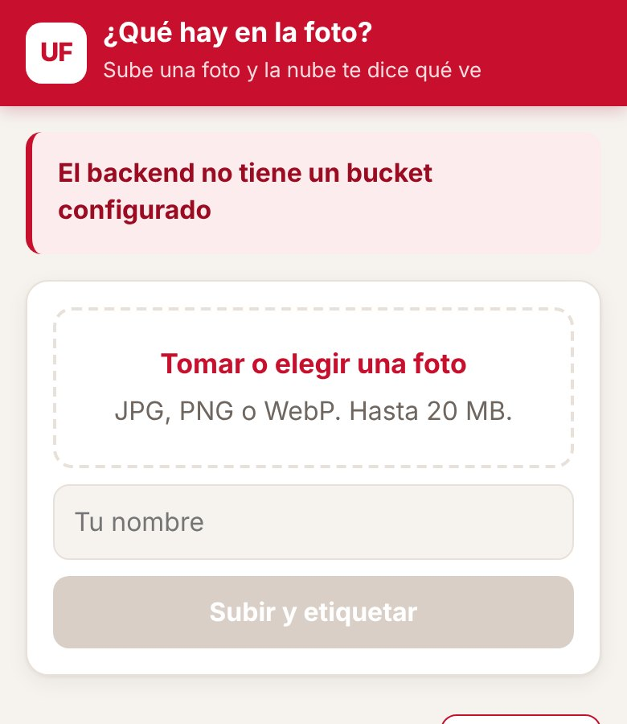
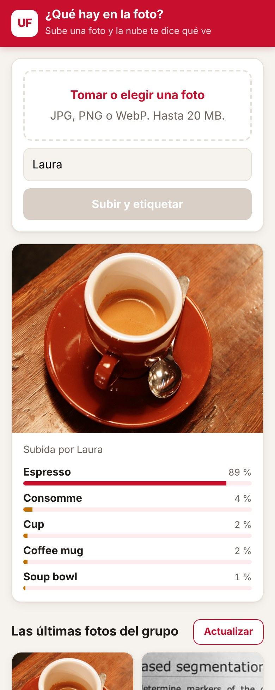
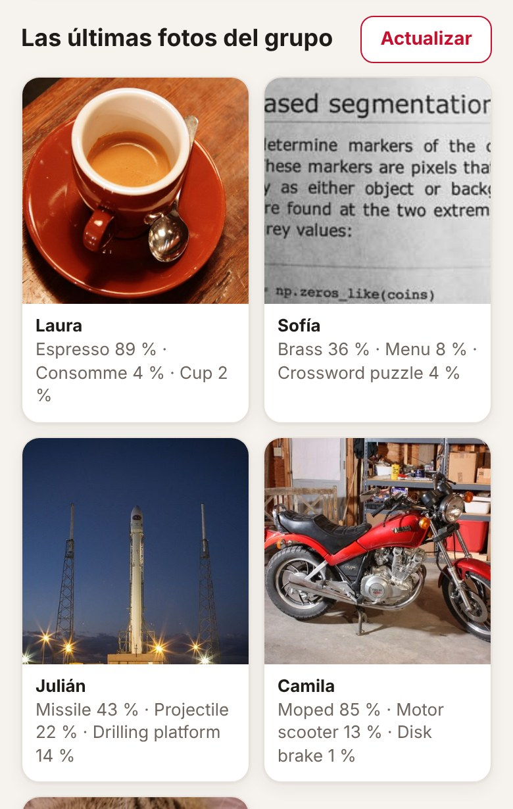
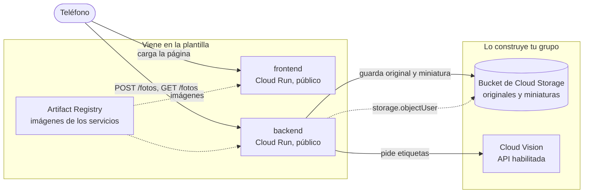

# ¿Qué hay en la foto?

Tomas una foto con el teléfono, la subes, y en un par de segundos la aplicación te dice qué ve en ella, con un porcentaje al lado de cada cosa. La foto queda guardada en un bucket de Cloud Storage y aparece en una galería con las últimas fotos del grupo. Quien reconoce lo que hay en la imagen no es código tuyo: es Cloud Vision, un modelo que Google ya entrenó y que se usa con una petición HTTP.

La plantilla trae las dos aplicaciones completas y la infraestructura del frontend y el backend. Tu grupo construye en Terraform el bucket, el permiso del backend sobre él y el acceso a Vision.

| Sin bucket todavía | Con etiquetas | La galería |
|---|---|---|
|  |  |  |

Las capturas salen de una prueba local: Cloud Storage simulado y, en lugar de Vision, un modelo de clasificación pequeño corriendo en el computador. Por eso las etiquetas de las capturas no son las de Vision; las reales las vas a ver cuando lo despliegues.

## Arquitectura al terminar la práctica



La flecha punteada es el único permiso de IAM que da tu grupo: la cuenta del backend puede crear, leer y listar objetos en ese bucket y en ningún otro. Para llamar a Vision no hace falta ningún rol: basta con que la API esté habilitada en el proyecto y con que el backend corra con una cuenta de servicio del mismo proyecto.

En la plantilla, la variable `BUCKET` del backend está vacía: responde que no tiene dónde guardar y no guarda nada. Es lo primero que vas a ver al desplegar.

## Estructura del repositorio

```
backend/main.py            API en Flask: recibe la foto, hace la miniatura, pide etiquetas y guarda en el bucket
backend/requirements.txt   Dependencias del backend con versión fija
backend/Dockerfile         Imagen del backend con gunicorn
frontend/index.html        La página: subir una foto, ver sus etiquetas y la galería del grupo
frontend/server.py         Servidor sin dependencias que inyecta BACKEND_URL en la página
frontend/Dockerfile        Imagen del frontend
infra/providers.tf         Versión de Terraform y del proveedor de Google
infra/variables.tf         Proyecto, prefijo, región e imágenes
infra/main.tf              APIs, registro, backend y frontend con sus cuentas
infra/outputs.tf           Ruta del registro y URL de los servicios
infra/terraform.tfvars.example   Ejemplo de valores; cópialo como terraform.tfvars
docs/api.md                Endpoints del backend y cómo se guardan las fotos
docs/capturas/             Capturas de la aplicación usadas en este README
.gitignore                 Deja por fuera el estado de Terraform, tus tfvars y __pycache__
```

## Cómo empezar

### Flujo de trabajo

1. Crea el repositorio de tu grupo con **Use this template** en GitHub.
2. Edita en VS Code o en github.dev (tecla `.` en la página del repositorio).
3. Haz commit y push desde el editor.
4. En Cloud Shell clonas la primera vez y traes los cambios con `git pull` después. Desde Cloud Shell nunca haces push.
5. Docker y Terraform se ejecutan siempre en Cloud Shell. La consola de Google Cloud es para mirar y diagnosticar, no para crear recursos.

### Primer despliegue

En Cloud Shell:

```bash
git clone https://github.com/<tu-usuario>/<tu-repositorio>.git
cd <tu-repositorio>/infra
cp terraform.tfvars.example terraform.tfvars
cloudshell edit terraform.tfvars
```

En `terraform.tfvars` pon el ID de tu proyecto y el prefijo del grupo, y ajusta las rutas de las imágenes a esos mismos valores. Este archivo vive solo en Cloud Shell: el `.gitignore` evita que llegue a GitHub.

El orden importa, porque las imágenes necesitan el registro y los servicios necesitan las imágenes:

```bash
# 1. Solo el registro (y las APIs de las que depende)
terraform init
terraform apply -target=google_artifact_registry_repository.registro

# 2. Las imágenes
REGISTRO=$(terraform output -raw registro)
gcloud auth configure-docker us-central1-docker.pkg.dev --quiet
cd ..
docker build -t $REGISTRO/backend:v1 backend
docker push $REGISTRO/backend:v1
docker build -t $REGISTRO/frontend:v1 frontend
docker push $REGISTRO/frontend:v1

# 3. Todo lo demás
cd infra
terraform apply
terraform output
```

Abre `url_frontend` en el teléfono. Si usas otra región, cambia `us-central1` en el comando de `gcloud auth configure-docker`, y ten en cuenta que la cuota gratuita de Cloud Storage solo aplica en `us-central1`, `us-east1` y `us-west1`.

Cuando cambies el código de un servicio, construye y sube la imagen con una etiqueta nueva (`v2`, `v3`...), actualízala en `terraform.tfvars` y vuelve a aplicar. Si subes otra vez la misma etiqueta, Terraform no ve ningún cambio y Cloud Run sigue con la versión anterior.

## Probar cada servicio con `docker run`

Antes de subir una imagen, pruébala en Cloud Shell. Para ver una página servida en Cloud Shell usa **Vista previa en la Web** y elige el puerto.

**Frontend.** No necesita credenciales:

```bash
docker run --rm -p 8080:8080 -e BACKEND_URL=https://<url-del-backend> $REGISTRO/frontend:v1
```

Abre la vista previa en el puerto 8080. Si no pasas `BACKEND_URL`, la página va a decir que no pudo hablar con el backend.

**Backend sin bucket.** El contenedor arranca aunque no tenga credenciales, y sin la variable `BUCKET` responde con un error claro:

```bash
docker run --rm -d --name backend -p 8081:8080 $REGISTRO/backend:v1
curl -i localhost:8081/fotos
docker logs backend
docker rm -f backend
```

Debe responder `503` con el error en JSON y una advertencia en los registros.

**Backend con bucket.** Cuando el bucket ya existe y la API de Vision está habilitada, puedes darle al contenedor tus propias credenciales:

```bash
gcloud auth application-default login
docker run --rm -d --name backend -p 8081:8080 \
  -e GOOGLE_CLOUD_PROJECT=<tu-proyecto> \
  -e BUCKET=<nombre-del-bucket> \
  -e GOOGLE_APPLICATION_CREDENTIALS=/adc.json \
  -v $HOME/.config/gcloud/application_default_credentials.json:/adc.json:ro \
  $REGISTRO/backend:v1
curl -X POST localhost:8081/fotos -F "autor=Ana" -F "foto=@una-foto.jpg"
curl localhost:8081/fotos
```

Los detalles de cada endpoint están en [docs/api.md](docs/api.md).

---

# Informe del grupo

## Integrantes

| Nombre | Código | Usuario de GitHub |
|---|---|---|
| | | |

## URL de la aplicación

Frontend:

## Diagrama propio

<!-- Tu diagrama en Mermaid de lo que desplegaste, con los nombres reales de tus recursos. -->

## Evidencias por fase

<!-- Una subsección por cada fase de la guía, con capturas o salidas de comandos y unas líneas de lo que observaste. -->

## Decisiones del reto

<!-- Qué cambiaste, por qué y cómo comprobaste que funciona. -->

## Preguntas

<!-- Las respuestas a las preguntas de la guía. -->
